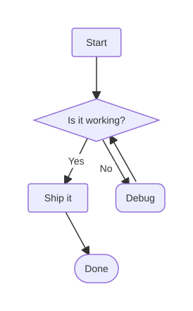
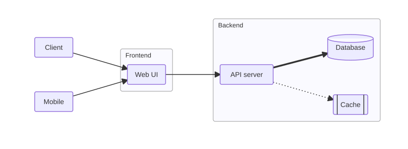
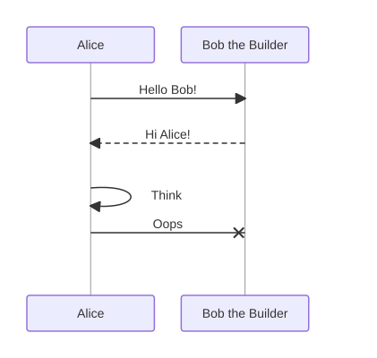
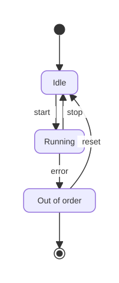
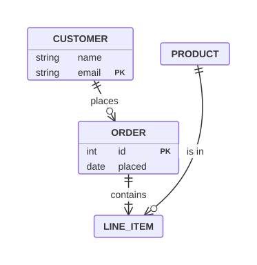
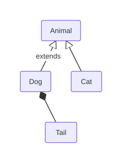
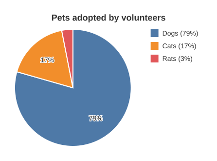
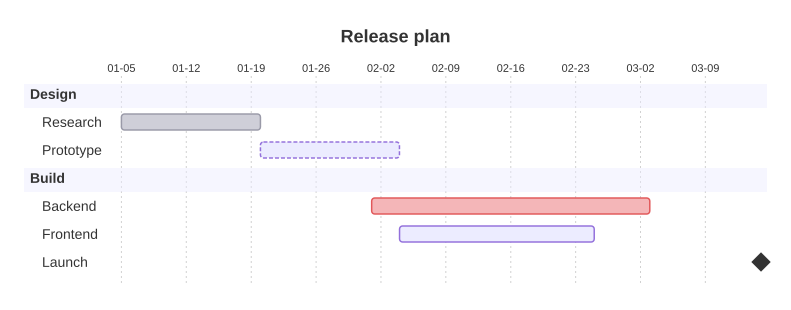

<h1 align="center">mermaid.mq</h1>

Render [Mermaid](https://mermaid.js.org/) diagrams to SVG with [mq](https://github.com/harehare/mq). No Node, no browser.

It can also draw diagrams as plain text for the terminal, parse them into data and write them back, and it works on Markdown: extract the Mermaid blocks of a document, or replace them with SVG images or text.

<p align="center">
  
  
  
  
  
  
  
  
</p>

## Quick start

Compile the command once. The `.mqc` format is tied to the mq version, so recompile after upgrading mq. Always pass `-I raw` when you run it.

```sh
mq compile -L . -I raw -f cli.mq -o mermaid.mqc
```

Render a diagram, or a diagram inside a Markdown document:

```sh
mq -I raw mermaid.mqc examples/flowchart.mmd -o flowchart.svg
mq -I raw mermaid.mqc --arg nth 2 doc.md -o second.svg        # 2nd mermaid block of doc.md
cat flow.mmd | mq -I raw mermaid.mqc > flow.svg                 # stdin works too
```

Draw it as text in the terminal:

```sh
mq -I raw mermaid.mqc --arg mode text examples/sequence.mmd
```

```
┌───────┐  ┌─────────────────┐
│ Alice │  │ Bob the Builder │
└───┬───┘  └────────┬────────┘
    │               │
    │  Hello Bob!   │
    ├──────────────>│
    │               │
    │   Hi Alice!   │
    │<┄┄┄┄┄┄┄┄┄┄┄┄┄┄┤
...
```

Pick a theme:

```sh
mq -I raw mermaid.mqc --arg theme dark flow.mmd -o flow-dark.svg
mq -I raw mermaid.mqc --arg theme auto flow.mmd -o flow.svg    # follows prefers-color-scheme
```

Replace every Mermaid block of a document with an image link and write the `.svg` files next to it. GitHub hides inline `<svg>` but shows images.

```sh
mq -I raw -W mermaid.mqc --arg mode files --arg write true docs/guide.md
```

```
docs/guide.md      a ```mermaid block becomes 
docs/guide-1.svg   the rendered diagram
```

`-W` lets the command write files. Without `--arg write true` the new Markdown is printed instead of overwriting the file, so you can check it first.

## Command line

| Argument | Description |
|---|---|
| `--arg mode M` | `svg` (default), `text`, `extract`, `parse`, `render` or `files` |
| `--arg nth N` | Diagram to use for `svg`, `extract` and `parse` (1 based, default 1) |
| `--arg theme T` | `light` (default), `dark` or `auto` |
| `--arg ascii true` | `text` and `render` with `format text`: draw with plain ASCII (`+`, `-`, `#`) instead of box drawing characters |
| `--arg format text` | `render`: replace blocks with fenced text instead of inline SVG |
| `--arg out_dir D` | `files`: directory for the `.svg` files, which must exist. Default: the directory of the input |
| `--arg link_dir D` | `files`: directory used in the image links. Default: none, or `out_dir` when it is given |
| `--arg name N` | `files`: file name prefix (`N-1.svg`, `N-2.svg`, ...). Default: the input file name without extension |
| `--arg write true` | `files`: overwrite the input with the new Markdown (needs `-W`) |

The input is a Markdown document (its mermaid blocks are used) or a single diagram.

| Mode | Output |
|---|---|
| `svg` | the SVG of one diagram |
| `text` | one diagram drawn as plain text |
| `extract` | the source of every block, or of block `nth` |
| `parse` | the parsed diagram. Add `-F json` for JSON |
| `render` | the Markdown with every block replaced by an inline SVG, or by a `text` code block with `--arg format text` |
| `files` | the Markdown with every block replaced by an image link. Writes the `.svg` files |

A block that cannot be rendered (an unsupported diagram type or a syntax error) is left as it is. In `files` mode it keeps its number, so `guide-3.svg` is still the third block when the second one was skipped.

## Supported diagrams

| Diagram | What is supported |
|---|---|
| Flowchart (`graph`, `flowchart`) | Directions `LR` `RL` `TD` `TB` `BT`. Shapes: rect `[ ]`, round `( )`, stadium `([ ])`, circle `(( ))`, diamond `{ }`, cylinder `[( )]`, subroutine `[[ ]]`, hexagon `{{ }}`. Links `-->` `---` `==>` `===` `-.->` `-.-` `<-->` `--x` `--o` with labels (`-->\|text\|` or `-- text -->`). Chains (`A --> B --> C`), groups (`A & B --> C`) and nested `subgraph` blocks |
| Sequence diagram | `participant` and `actor` with `as` aliases. Arrows `->>` `-->>` `->` `-->` `-x` `--x`, with or without spaces around them. Messages to self |
| Class diagram | Classes and relations `<\|--` `*--` `o--` `--*` `--o` `--` with labels. Members are not supported |
| State diagram | `stateDiagram` and `stateDiagram-v2`. Transitions with labels, `[*]` start and end, `state "Label" as id`, `id : description`, `direction`. Composite states are flattened |
| ER diagram | Relations with all cardinalities, solid and dashed lines, labels. Entity blocks with attributes, `PK` `FK` `UK` keys and comments |
| Gantt chart | `title`, `section`, tasks with `done` `active` `crit` `milestone` tags, an id, a start date or `after id`, and an end date or a duration (`10d`, `2w`). Dates are `YYYY-MM-DD`. Other settings are ignored |
| Pie chart | Title and labeled slices |

Anything else is parsed as `{ type, raw_lines }` and cannot be rendered.

### Text output

`mode text` draws a diagram with box drawing characters, so it can be read in a terminal, a commit message or an LLM prompt. CJK characters count as two columns, so boxes stay aligned. Use `--arg ascii true` for terminals and fonts without box drawing characters.

```sh
mq -I raw mermaid.mqc --arg mode text examples/flowchart.mmd
```

```
       ┌───────┐
       │ Start │
       └───────┘
           │
           │
           │
           v
 ┌───────────────────┐
 │ {Is it working?}  │
 └───────────────────┘
           │ ^
     ┌─Yes─┤ │
     │     └─┼No───┐
     │       └─────┼──────┐
     │             │      │
     v             v      │
  ...
```

| Diagram | Text output |
|---|---|
| Flowchart | boxes in layers joined by lines with arrowheads (`>` `v` `<` `^`, `x`, `o`) and labels. `TD` and `LR`. Shapes are shown with their Mermaid brackets, such as `{Choice}`, `((Circle))` and `[(Db)]` |
| State diagram | rounded boxes, `●` for the start and `◉` for the end |
| Class diagram | boxes with `△` (inheritance), `◆` (composition) and `◇` (aggregation) at the end of the line |
| ER diagram | entity boxes with their attributes, and cardinalities (`1`, `0..1`, `0..*`, `1..*`) at both ends of a relation |
| Sequence diagram | participant boxes, lifelines, solid and dashed arrows, `>` and `x` heads, messages to self |
| Pie chart | one bar per slice with percentage and value |
| Gantt chart | a date axis and one bar per task, with a different character for `done`, `active`, `crit` and `milestone` |

Text output has a few limits: `RL` is drawn as `LR` and `BT` as `TD`, subgraphs are not drawn, and thick and dotted lines look like plain ones. An edge that does not go to the next layer runs in a lane beside the diagram. Diagrams that cannot be drawn as text (such as `journey`) raise an error. With `render` and `--arg format text` they are left as they are.

### Theming

Colors are applied through CSS classes, and each color is a CSS variable with a fallback. Inline the SVG and set the variables on it or on a parent to restyle a diagram without rendering it again.

```css
.diagram { --mm-bg: #fffbeb; --mm-node: #fef3c7; --mm-stroke: #d97706; --mm-edge: #92400e; --mm-fg: #451a03; }
```

| Variable | Used for |
|---|---|
| `--mm-bg` | background, and the outline of labels drawn over shapes |
| `--mm-fg` | text |
| `--mm-node` | fill of nodes, classes, entities and participants |
| `--mm-stroke` | border of those shapes |
| `--mm-edge` | edges, arrowheads and message lines |
| `--mm-life` | lifelines, grid lines and group borders |

Variables only apply to an inlined SVG, not to one loaded through ``. Use `--arg theme auto` there.

### Limitations

- Edges are straight lines. An edge that would cross another node is drawn as a curve around it.
- Subgraph boxes are drawn around their members. The layout does not keep other nodes out of a box, so an unrelated node can overlap it.
- `style`, `classDef`, `linkStyle` and `click` lines are ignored. Edges to a subgraph are not supported.
- Gantt only reads `YYYY-MM-DD` dates and durations in days or weeks.
- `render` and `files` match blocks fenced with three backticks.
- mq limits the depth of nested calls, so a diagram with thousands of nodes can fail with `Maximum recursion depth exceeded`.

## Using it as a module

Copy `mermaid.mq` to your mq module directory, or place it anywhere and reference it with `-L`.

```sh
cp mermaid.mq ~/.local/mq/config/
mq -L . -I raw 'import "mermaid" | mermaid::mermaid_to_svg(.)' diagram.mmd
```

If `mq` was built with the `http-import` feature you can import from GitHub. This needs the `--allow-http-import` flag, which is off by default. Pin a release with `@vX.Y.Z`.

```sh
mq --allow-http-import -I raw 'import "github.com/harehare/mermaid.mq" | mermaid::mermaid_to_svg(.)' diagram.mmd
```

| Function | Description |
|---|---|
| `mermaid_to_svg(x)` | SVG string for Mermaid text or a parsed diagram |
| `mermaid_to_svg_with(x, opts)` | Same with options. `{"theme": "light" \| "dark" \| "auto"}` |
| `mermaid_to_text(x)` | Plain text drawing of a diagram |
| `mermaid_to_text_with(x, opts)` | Same with options. `{"ascii": true}` |
| `mermaid_extract(md)` | Array with the source of every mermaid block of a Markdown string |
| `mermaid_render_markdown(md)` | Markdown with every block replaced by an inline SVG |
| `mermaid_render_markdown_with(md, opts)` | Same with options. `{"format": "text"}` uses text code blocks instead of SVG |
| `mermaid_svgs(md, opts)` | One SVG per block, or `None` for a block that cannot be rendered |
| `mermaid_link_markdown(md, path_fn, opts)` | Markdown with each renderable block replaced by `)`. `N` counts all blocks from 1 |
| `mermaid_parse(text)` | Structured data, see below |
| `mermaid_stringify(diagram)` | Mermaid text for a parsed diagram |
| `mermaid_run(input, args, file)` | Entry point of the command. `args` is the dict of `--arg` |

`mermaid_svgs` and `mermaid_link_markdown` together do what `--arg mode files` does, without writing files:

```mq
import "mermaid"
| let opts = {"theme": "auto"}
| let svgs = mermaid::mermaid_svgs(md, opts)
| mermaid::mermaid_link_markdown(md, fn(n): "img/fig-" + to_string(n) + ".svg";, opts)
```

### Parsed data

| Diagram | Keys |
|---|---|
| flowchart | `type`, `direction`, `nodes` (`id` `label` `shape`), `edges` (`from` `to` `label` `op`), `subgraphs` (`id` `title` `nodes` `parent`) |
| sequenceDiagram | `type`, `participants` (`name` `alias`), `messages` (`from` `to` `arrow` `text`) |
| classDiagram | `type`, `classes`, `relations` (`from` `to` `rel` `label`) |
| stateDiagram | `type`, `direction`, `states` (`id` `label`), `transitions` (`from` `to` `label`) |
| erDiagram | `type`, `entities` (`name` `attributes`), `relations` (`from` `to` `left` `line` `right` `label`) |
| gantt | `type`, `title`, `sections` (`name` `tasks`). A task has `name` `id` `tags` `start` `end`, and `after` and durations are already resolved to dates |
| pie | `type`, `title`, `slices` (`label` `value`) |
| other | `type`, `raw_lines` |

`mermaid_stringify` turns this data back into Mermaid text, so you can parse, change and write a diagram:

```sh
# Lossless round trip
mq -L . -I raw 'import "mermaid" | mermaid::mermaid_parse(.) | mermaid::mermaid_stringify(.)' flow.mmd

# Add a node, then write the diagram again
mq -L . -I raw 'import "mermaid" | mermaid::mermaid_parse(.) | . + {"nodes": ."nodes" + [{"id":"F","label":"New","shape":"rect"}]} | mermaid::mermaid_stringify(.)' flow.mmd

# Node ids of a flowchart
mq -L . -I raw 'import "mermaid" | mermaid::mermaid_parse(.) | ."nodes" | map(fn(n): n["id"];)' flow.mmd

# Messages sent by Alice
mq -L . -I raw 'import "mermaid" | mermaid::mermaid_parse(.) | ."messages" | filter(fn(m): m["from"] == "Alice";)' seq.mmd

# Diagram types used in a document
mq -L . -I raw 'import "mermaid" | mermaid::mermaid_extract(.) | map(fn(s): mermaid::mermaid_parse(s)["type"];)' doc.md
```

## Testing

```sh
mq-test mermaid_tests.mq
```

`examples/*.svg` are generated with the command. Regenerate them after changing a renderer:

```sh
for f in examples/*.mmd; do mq -I raw mermaid.mqc --arg theme auto "$f" > "${f%.mmd}.svg"; done
```

## Compatibility

Requires [mq](https://github.com/harehare/mq) v0.9.3 or later. `mq compile` is experimental, so recompile `mermaid.mqc` after upgrading mq.

## License

MIT
